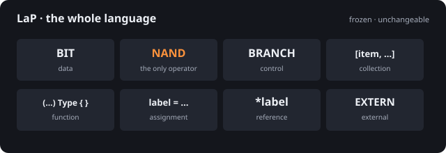
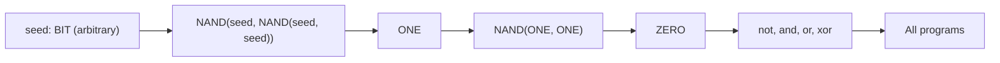

# Labels & Primitives

**Eight primitives. One operator. A spec that doesn't move.**

LaP is a tiny language with a frozen spec. A `.lap` file written today should still compile in fifty years. The spec does not move. The tool does.

{ width="560" style="max-width: 100%; height: auto;" }

[Source code](https://github.com/VantorreWannes/lapzt)

## Why freeze it?

Most languages grow. New versions add features, deprecate old ones, and quietly break programs that worked yesterday. LaP takes the opposite bet: keep the spec small and stop changing it.

- **Programs outlive their toolchain.** A `.lap` file from 2026 should compile on a 2076 compiler.
- **Skills transfer.** If you know LaP, you know LaP. There is no version to relearn.
- **Tools compete, not the language.** Anyone can write a new backend, runtime, or optimizer without changing what users see.

The spec is the contract. Everything else is implementation.

## Eight primitives

The whole language:

- `BIT`: the data primitive. A single bit, starting in an arbitrary state.
- `NAND`: the operation primitive. The only operator.
- `BRANCH`: the branching primitive. Pick a block based on a bit.
- `[item, ...]`: the collection primitive. An ordered list of mixed values.
- `(params) Type { ... }`: the function definition primitive.
- `label = ...`: the assignment primitive. Copy a value into storage.
- `*label`: the reference primitive. Alias existing storage.
- `EXTERN`: the external primitive. Memory, I/O, and the outside world.

No keywords. No built-in numbers or strings. No operators beyond `NAND`. A small surface area is what makes the spec freezable in the first place. There is nothing left to add.

## One operator, everything else

**`NAND(a, b)` is functionally complete.** Every other logical operation is derived from it:

- `not a = NAND(a, a)`
- `a and b = NAND(NAND(a, b), NAND(a, b))`
- `a or b = NAND(NAND(a, a), NAND(b, b))`
- `a xor b = NAND(NAND(a, NAND(a, b)), NAND(b, NAND(a, b)))`

Even `ZERO` and `ONE` have to be derived, because bits start in an arbitrary state:



One operator means there is nothing to extend, deprecate, or replace. The logic layer is done.

## The rules

A few design rules keep the spec stable:

- **No keywords.** Identifiers are infix-separated.
- **Nominal types.** Identical layouts, different names, different types.
- **Stack-only references.** Take them, mutate through them, never return them.
- **`EXTERN` for everything outside the language.** The spec says nothing about what operations exist.

## The tool

`lapzt` is the only tool today. It transpiles Lap to Zig.

- `lapzt compile <files>`: emit Zig. Files are concatenated in argument order.
- `lapzt check <files>`: report errors without emitting code.
- `lapzt std`: print the liblapzt standard library.

Labels are erased by default. A label over two bits becomes a Zig `u2`, and its operations become native integer operations. `--no-erasure` keeps the layout as a struct of bits instead of packing it into an integer.

## The standard library

`liblapzt` is written in Lap, on the same eight primitives. It adds no syntax and no built-ins.

- `u0` to `u128`, `i2` to `i128`, `f16` to `f128`: fixed-width numbers up to 128 bits, built from `BIT` and `NAND`.
- `bool`, `option`: labels over bits.
- `io`, `memory`, `process`: the outside world, through `EXTERN`.
- `print`, `assert`: output and checks, built on `io`.

The library reaches the outside world only through `EXTERN`: `OP.READ`, `OP.WRITE`, `OP.MEMORY.ACQUIRE`, `OP.MEMORY.RELEASE`, and `OP.EXIT`. The spec still says nothing about what those operations do.

`lapzt std` prints all of it. Save it, pass it first, and the rest of the program can use it.

## Performance

The spec is small, but the output is not slow. `lapzt` emits Zig, so there is no interpreter, no garbage collector, and no dynamic dispatch.

- **Labels cost nothing at runtime.** Erasure turns a `u64` into a Zig `u64` and its operations into native integer operations.
- **Standard library calls lower to operators.** `u64.add` becomes `+`, `u64.div` becomes `/`, `u64.not` becomes `~`. The NAND derivation is the spec; the machine code is not.
- **`EXTERN` is the only boundary.** Memory and I/O are a handful of calls into a small Zig shim.

The trade is compile time for run time. The spec makes that trade on purpose.

## Try it

```
./lapzt std > liblapzt.lap
./lapzt check liblapzt.lap main.lap
./lapzt compile liblapzt.lap main.lap > main.zig
```

```
xor = (a: BIT, b: BIT) BIT {
    n = NAND(a, b)
    NAND(NAND(a, n), NAND(b, n))
}

main = () [] {
    one = NAND(BIT, NAND(BIT, BIT))
    liblapzt.assert.true(liblapzt.u1.eq(xor(one, one), liblapzt.u1.zero))
    []
}
```

XOR from four NANDs. `main` returns `[]`, and the assertion holds.
